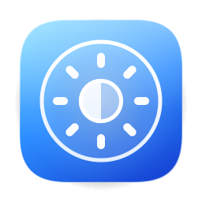
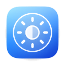

<p align="center">
  
</p>

<h1 align="center">Lumina</h1>

<p align="center">App menu bar cho macOS: nhận diện màn hình, chỉnh độ sáng và độ phân giải cho từng màn.</p>

## Tính năng

- **Nhận diện màn hình** đang cắm (tên, hãng, kích thước), tự cập nhật khi cắm/rút hay đổi chế độ.
- **Độ sáng**: màn tích hợp qua DisplayServices; màn ngoài qua **DDC/CI phần cứng** (vd Kuycon P27G); màn không có DDC thì làm tối bằng gamma.
- **Độ phân giải**: thanh trượt các mức cùng loại và cùng tỉ lệ + danh sách mọi chế độ; **công tắc HiDPI** (giữ kích thước nếu có); **chọn tỉ lệ** theo những gì màn hỗ trợ (5:4, 4:3, 16:10, 16:9, 21:9, 32:9…; "Gốc" là tỉ lệ tấm nền, vd MacBook có dải tai thỏ). Mọi thay đổi **tự hoàn tác sau 15 giây** nếu không bấm "Giữ".
- **HDR** — công tắc "Dải động cao" cho màn ngoài hỗ trợ HDR (như trong Cài đặt hệ thống › Màn hình), ở đầu thẻ màn cả popover và cửa sổ.
- **Màu cho tương xứng với Mac** (cửa sổ, màn ngoài): hồ sơ màu **Display P3** (cùng gam màu với màn Mac) và **điểm trắng R/G/B qua DDC** để chỉnh bằng mắt cho trắng giống Mac (D65), có nút Khôi phục về giá trị gốc. macOS chỉ có "chế độ màu" (preset tham chiếu) cho màn Apple; màn hãng khác chỉ có HDR + hồ sơ màu.
- Popover **Liquid Glass** (macOS 26+), neo đúng dưới icon kể cả khi đổi độ phân giải hay đổi màn chính; accordion; không cuộn giao diện chính — phần nào không đủ chỗ (danh sách chế độ, danh sách công cụ) thì tự co và cuộn bên trong.
- **Công cụ** — một mục thu gọn, bấm là sổ ra danh sách (cao có giới hạn, dài hơn thì cuộn bên trong). Công cụ có phần riêng (Sắp xếp, Xoay) mở thành trang thay chỗ danh sách, có nút quay lại. Công cụ nào đang có hiệu lực thì hiện icon phát sáng ở tiêu đề mục; bấm icon đó là tắt, không cần mở mục.
  - **Ngăn ngủ** — giữ màn hình và máy không tự ngủ khi để yên (IOPM assertion, tự gỡ khi tắt hoặc thoát app).
  - **Đồng bộ độ sáng** — các màn khác sáng bằng số nit (ước lượng) của màn tích hợp, bám theo cả phím độ sáng và chế độ tự chỉnh theo ánh sáng phòng. Mỗi màn có đường quy đổi riêng: MacBook Pro XDR ~1–600 nit theo cảm nhận (số đo: tối đa 540–646, tối thiểu 1,2 nit; 1000 nit chỉ khi môi trường sáng và bật tự chỉnh độ sáng — lúc đó Lumina không biết macOS đẩy thêm bao nhiêu), Kuycon P27G ~50–500 nit tuyến tính qua DDC (500 nit theo thông số bán lẻ). Chỉnh nit tối đa/tối thiểu trong cửa sổ; khi đang đồng bộ, kéo thanh của màn phụ cho khớp mắt thì Lumina nhớ mức bù đó.
  - **Sắp xếp màn hình** — bản đồ thu nhỏ, kéo-thả một màn (tự hít vào cạnh màn bên cạnh, không chồng) và **chọn màn chính** (menu bar, Dock).
  - **Phản chiếu màn hình** — bật: mọi màn hiện giống màn chính; tắt: mở rộng (extend), mỗi màn một desktop.
  - **Xoay màn hình** — 0°/90°/180°/270° cho từng màn (MonitorPanel, private); cũng tự hoàn tác sau 15 giây.
- **Cửa sổ Lumina** — bấm Lumina.app trong Applications (hoặc nút cửa sổ trên popover) để mở cửa sổ tuỳ chỉnh đầy đủ kiểu Cài đặt hệ thống (Form grouped gốc của macOS): từng màn (số liệu, độ sáng, độ phân giải, bố cục, HDR và màu, độ sáng thật), công cụ, cài đặt chung. Cửa sổ và popover **dùng chung một trạng thái** nên đổi ở đâu cũng hiện ngay ở chỗ kia. Khi cửa sổ mở app hiện ở Dock; đóng cửa sổ thì trở lại chạy nền.
- Không hiện ở Dock khi chạy nền, **mở cùng máy** (mở cùng máy thì chỉ chạy nền, không bật cửa sổ).
- CLI: `Lumina list | get-brightness | set-brightness | set-resolution | arrange | login-item | vcp`.

## Icon

| Icon app | Icon menu bar |
|---|---|
|     |   |

Khối kính ba cánh màu chuyển cyan → xanh → tím trên nền sáng pastel, lõi phát sáng trắng (kiểu icon macOS 26/27).

- `scripts/make-icon.swift` — nguồn của icon: vẽ bằng CoreGraphics + CoreImage (lớp kính, ánh phản chiếu, quầng sáng, bóng đổ), xuất `Resources/AppIcon.icns` và PNG các cỡ.
- `Resources/AppIcon.icns` — icon đóng vào app (đã commit sẵn, build không cần sinh lại).
- `Resources/Icons/` — PNG các cỡ để xem. Icon menu bar vẽ bằng code trong `MenuBarIcon.draw()` (app) và `glyph()` (script), cùng hàm hình học `trefoil`.

Đổi icon: sửa `scripts/make-icon.swift`, rồi

```bash
swift scripts/make-icon.swift
```

## Build

**Yêu cầu** (đã build và chạy với đúng cấu hình này):

| | |
|---|---|
| Máy | Apple Silicon (arm64) |
| macOS | 27.2 (chạy được từ macOS 14; Liquid Glass cần macOS 26+) |
| Công cụ | Command Line Tools với Swift 6.4.2, SDK macOS 27.2 — **không cần Xcode** |
| Phụ thuộc ngoài | không có |

Build và đóng gói `build/Lumina.app` (ký ad-hoc):

```bash
scripts/bundle.sh
```

Build, cài vào `/Applications` (thay bản cũ) rồi mở:

```bash
scripts/bundle.sh --install && open /Applications/Lumina.app
```

Chạy test logic (55 test):

```bash
scripts/test.sh
```

Kiểm tra trên máy thật (cần một màn ngoài; mọi thay đổi được trả lại như cũ khi xong):

```bash
build/Lumina.app/Contents/MacOS/Lumina --tools-test    # bấm thật vào mục Công cụ, xoay, HiDPI, tỉ lệ, màn chính, phản chiếu
build/Lumina.app/Contents/MacOS/Lumina --window-test   # cửa sổ ↔ popover đồng bộ
build/Lumina.app/Contents/MacOS/Lumina --fit-test      # popover vừa màn tích hợp khi mở hết
build/Lumina.app/Contents/MacOS/Lumina --sync-test     # đồng bộ độ sáng, đọc ngược DDC của màn ngoài
build/Lumina.app/Contents/MacOS/Lumina --color-test    # HDR (popover ↔ cửa sổ), điểm trắng qua DDC, Display P3
build/Lumina.app/Contents/MacOS/Lumina --profile       # đo bộ nhớ khi mở/đóng popover và cửa sổ nhiều lần (PROFILE_WINDOWS, PROFILE_IDLE)
build/Lumina.app/Contents/MacOS/Lumina --main-trace [--builtin]   # đổi màn chính qua lại khi popover mở, kiểm tra popover vẫn neo dưới icon
build/Lumina.app/Contents/MacOS/Lumina vcp <id> <mã hex> [giá trị]   # đọc/ghi một mã DDC/CI
```

### Lưu ý khi build bằng Command Line Tools

- Trên SDK macOS 27, `@State` của SwiftUI là macro mà plugin chỉ có trong Xcode, nên code dùng alias `@ViewState` (`Sources/Lumina/UI/ViewState.swift`). Đừng đổi lại thành `@State`.
- Chạy test bằng `scripts/test.sh`, không dùng `swift test` trần: với Command Line Tools, SwiftPM không tự nạp plugin macro của swift-testing (nằm trong `host/plugins/testing/`), nên `swift test` có lúc báo `plugin for module 'TestingMacros' not found`. Script chỉ thẳng đường dẫn plugin cho trình biên dịch.
- App ký ad-hoc (`codesign -s -`): chạy được trên máy build. Sang máy khác macOS sẽ chặn vì không có chữ ký Apple.
- Private API (DisplayServices, IOAVService) được nạp bằng `dlsym`; thiếu hàm nào thì tính năng đó tự ẩn, app không crash.

## Cấu trúc

```
Sources/LuminaCore/   logic thuần, có test: chế độ hiển thị, gói DDC, ghép DDC theo EDID, vị trí popover, tự hoàn tác, hít cạnh khi sắp xếp màn
Sources/Lumina/       app: System/ (CoreGraphics, DDC, độ sáng, login item), UI/ (popover, thẻ màn hình), CLI
Tests/                swift-testing
Resources/            Info.plist, icon
scripts/              bundle.sh, sinh icon
docs/                 tài liệu thiết kế và kế hoạch
```

Thiết kế UI trên Claude Design: https://claude.ai/artifact/KUfGxci9hwnDPHiwVaCRtm
